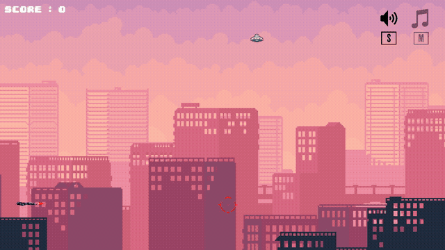
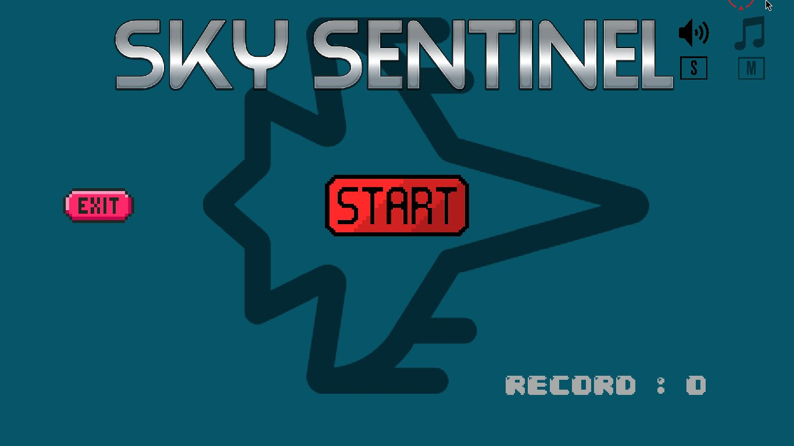
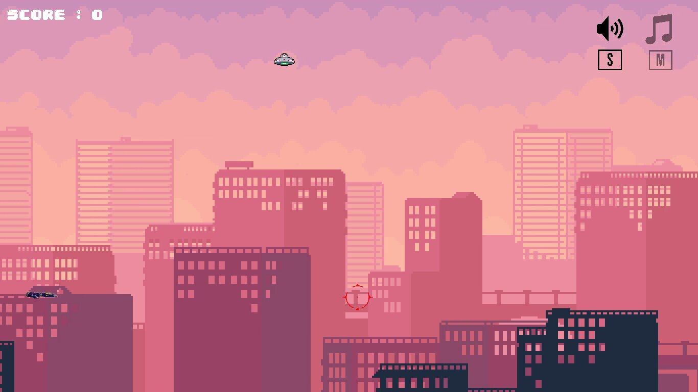

# Sky Sentinel — My Hunter (Epitech, 1re année)

> **EN** — A 2D shooter written in C with CSFML, my first graphical project at Epitech (Nov. 2023, solo).
> The player pilots a fighter jet that follows the mouse and shoots down UFOs crossing the sky; aliens speed up as the score doubles.

**Sky Sentinel** est ma version du projet **My Hunter** d'Epitech. Le sujet demande un petit jeu dans l'esprit de *Duck Hunt* :
des cibles animées traversent l'écran et le joueur les abat à la souris. Le but pédagogique : gérer les entrées
de l'utilisateur et afficher des sprites animés, les bases de tout jeu vidéo.

Plutôt que des canards, j'ai fait un jeu d'avion : on pilote un chasseur qui suit la souris, et on abat les
soucoupes volantes qui foncent vers lui au-dessus d'une ville en pixel art.

| Menu | En jeu |
| --- | --- |
|  |  |

🎬 Vidéo : [media/gameplay.mp4](media/gameplay.mp4)

## Le jeu

- **Menu** avec boutons *Start* / *Exit*, record de la session et réglages du son.
- **Avion piloté à la souris** : il monte ou descend vers le curseur en s'inclinant, avec une petite oscillation en vol.
- **Tir au clic** : l'avion fait feu (sprite de tir et son) ; une soucoupe alignée avec l'avion est détruite et réapparaît plus loin, à une hauteur aléatoire.
- **Difficulté progressive** : chaque fois que le score double (6, 12, 24…), les soucoupes accélèrent, et le décor défile plus vite.
- **Esquive** (Espace) : un tonneau animé qui rend l'avion invulnérable un court instant.
- **Game over** quand une soucoupe touche l'avion, avec animation d'explosion, puis retour au menu et mise à jour du record.
- **Décor en parallaxe** : deux images de ville qui défilent en boucle sans couture.
- Musique (M) et bruitages (S) activables séparément ; `./my_hunter -h` affiche l'aide.

| Touche | Action |
| --- | --- |
| Souris | Diriger l'avion |
| Clic | Tirer |
| Espace | Esquive (tonneau) |
| M / S | Musique / bruitages |
| Entrée | Abandonner la partie |
| Échap | Quitter |

## Technique

- **Langage** : C (norme de code Epitech), **bibliothèque** : CSFML 2.5 (graphismes, fenêtre, audio).
- Fonctions de la libC interdites sauf quelques exceptions (malloc, free, rand…) : conversion entier → texte du score écrite à la main.
- ~700 lignes : `main.c` (boucle de jeu, game over), `LIB/create.c` (chargement des textures et sons), `LIB/draw.c` (rendu et défilement), `LIB/events.c` (souris, clavier, collisions, score).
- Animation par **sprite sheets** : le rectangle de texture se décale à chaque tick d'horloge (`sfClock`), indépendamment du framerate (limité à 60 i/s).
- Collisions avec `sfFloatRect_intersects` entre la soucoupe et l'avion.

Détails : [docs/ARCHITECTURE.md](docs/ARCHITECTURE.md) · Installation : [docs/INSTALL-fedora.md](docs/INSTALL-fedora.md)

## Mon rôle

Projet **solo** : conception du jeu, code, intégration des sprites et des sons (novembre 2023, 24 commits). La dernière journée a servi au polissage : effet de défilement du fond, affichage à l'origine (0, 0),
sprites de l'avion.

## Code source

Le code source et son historique complet sont dans un dépôt privé :
[FuniclemDev/my-hunter-source](https://github.com/FuniclemDev/my-hunter-source) (accès sur demande).
Ce dépôt public ne contient que la présentation, la documentation et les médias : le code des projets Epitech
n'est pas publié en accès libre.

---
Clément Dorge · [clementdorge.com](https://clementdorge.com/fr/projets/my-hunter/) · Epitech Strasbourg
